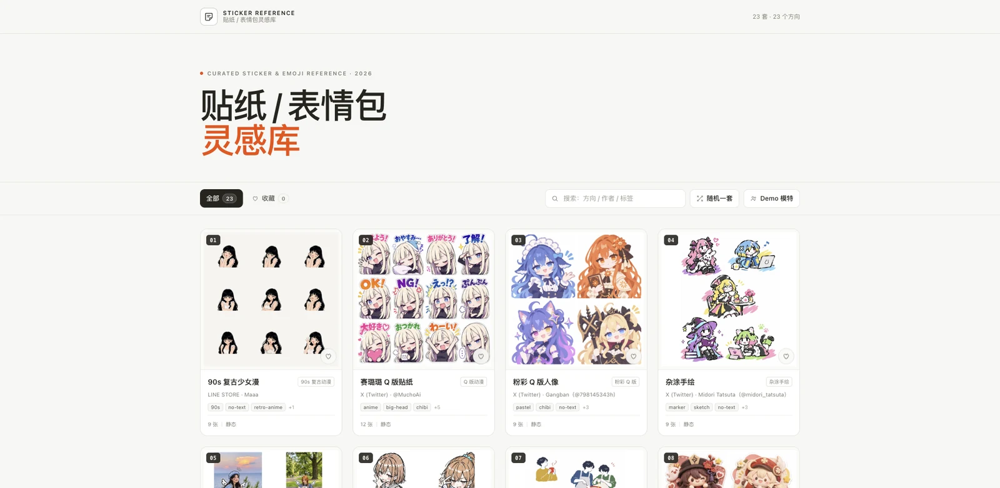
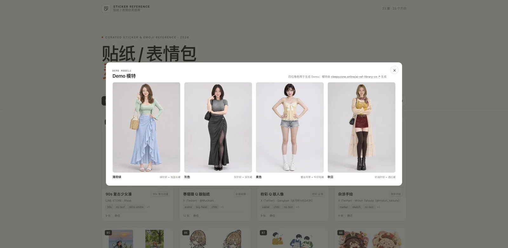
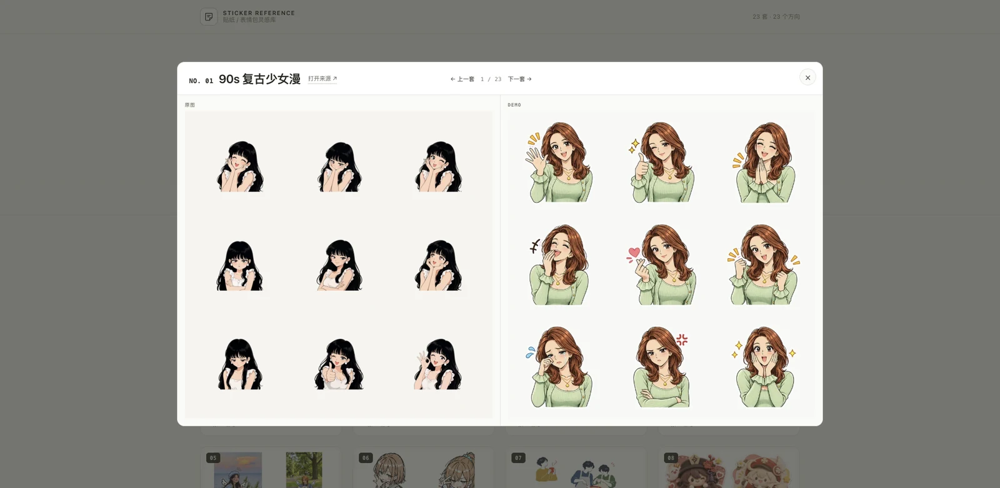
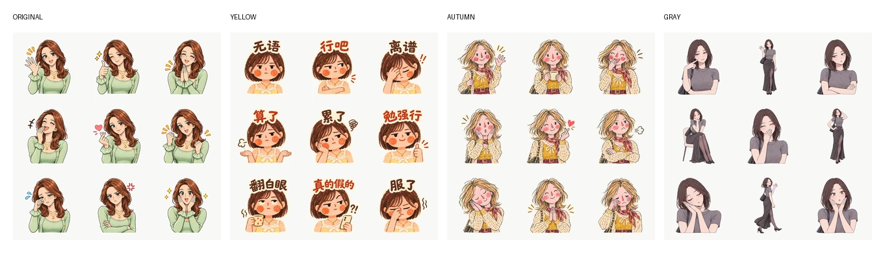
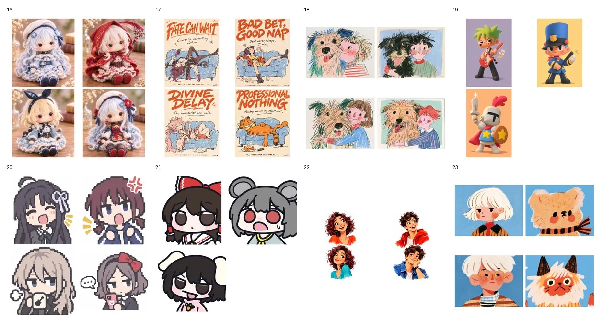

# 贴纸 / 表情包灵感库

独立静态站：23 套人像 / 角色表情包，23 个不同方向。





- 90s 复古动漫、Q 版动漫、粉彩 Q 版人像、杂涂手绘、照片手绘混合、稚拙涂鸦、柔和绘本、软陶立体贴纸、圆润 Q 版、猫猫反应表情、柔和灰调动漫、蜡笔质感、粉色贴纸排版、和纸拼贴、日文粉彩大头、羊毛毡娃娃、Riso 独立志、儿童蜡笔肖像、3D 搪胶玩具、像素 Q 版、粗黑线梗图、手绘动画概念、简笔水粉头像
- 支持搜索、收藏、随机打开
- 工具栏「随机一套」右侧的「Demo 模特」按钮，点击弹窗展示四位模特（模特由 https://sleepyzone.online/ai-ref-library-cn/ 生成）
- 首页预览展示原始引用图；详情左侧原图、右侧 Demo；标题、来源、上一套/下一套都在顶部
- Demo 在详情右侧展示；ZIP 与单张图已移出到本地归档，站点只保留展示预览
- 无构建、无后端，直接静态托管



## 四个角色



- 01、04、06、14、17、20：最初的参考角色
- 02 / 03 / 07 / 10 / 12 / 13 / 15 / 19 / 23：黄色蕾丝吊带角色
- 08 / 16 / 18 / 22：秋日针织角色
- 05 / 09 / 11 / 21：灰色极简角色

Pack 统一以上半身表情为主；01 / 03 / 04 / 05 / 07 / 08 / 09 / 11 / 12 / 14 / 16 / 18 / 19 / 20 / 21 / 22 为 9 张无字版；10 / 13 / 15 / 17 / 23 为 9 张带字版；其余 2 套为 12 张，512×512 透明 PNG。

## 容易混的五组

- **01 90s 复古动漫 vs 11 柔和灰调动漫**：前者是少女漫半身、柔光；后者是细线、低饱和灰调、灰色基础款。
- **03 粉彩 Q 版人像 vs 05 照片手绘混合**：前者是粉彩大头、粗白边；后者是照片脸 + 手绘身体。
- **04 杂涂手绘 vs 06 稚拙涂鸦**：前者还有基本结构和马克笔排线；后者故意更歪、更断、更留白，重点在笨拙感。
- **06 稚拙涂鸦 vs 12 蜡笔质感**：06 是数字涂鸦、粗歪线、无排线；12 是蜡笔/彩铅颗粒、斜向排线、白底彩点。
- **02 Q 版动漫 vs 09 圆润 Q 版**：前者是 12 格 + 文字；后者单角色、圆脸软阴影、无字。

## 新增 8 套



## Pack

- 23 套都有 Pack：01 / 03 / 04 / 05 / 07 / 08 / 09 / 11 / 12 / 14 / 16 / 18 / 19 / 20 / 21 / 22 为 9 张无字版；10 / 13 / 15 / 17 / 23 为 9 张带字版；其余 2 套为 12 张；原始文件在本地归档
- 四个角色：01、04、06、14、17、20 使用最初参考角色；02 + 03 + 07 + 10 + 12 + 13 + 15 + 19 + 23 用黄色吊带角色，08 + 16 + 18 + 22 用秋日针织角色，05 + 09 + 11 + 21 用灰色极简角色
- 原始 ZIP、单张 PNG、source sheet 和 skill 在 `../sticker-library-assets/`，不进入本站 Git；生成方法见该目录的 `README.md`


## 本地预览

```bash
cd sticker-library-cn
python3 -m http.server 8080
# open http://localhost:8080
```

也可以直接双击 `index.html`（数据用 `data/sticker-sets.js` 挂全局变量，避免 `file://` 下 fetch 被拦）。

## 文件

```
sticker-library-cn/
├── index.html
├── assets/
│   ├── style.css
│   ├── app.js
│   └── favicon.svg
├── data/
│   └── sticker-sets.js     # 站点直接读这份
├── images/
│   ├── pack-previews/       # 站点用 Pack 预览（WebP）
│   ├── models/              # Demo 模特图
│   └── ...                  # 原始引用图展示副本
└── screenshots/             # README 截图
```

## 功能

- 筛选：全部 / 收藏
- 搜索：标题、作者、平台、方向、标签、描述（不按题材分类）
- 收藏：存 `localStorage`，可只看收藏
- 随机一套
- 详情：左侧原图、右侧 Demo；顶部标题、来源、上一套/下一套
- 深链：`#s01` 到 `#s23`
- Esc / 左右方向键 / 点遮罩关闭详情
- 移动端全屏详情

## 部署

纯静态，把整个目录上传即可：

- **GitHub Pages**：仓库根目录或 `docs/` 下放本目录；用相对路径，项目子路径 `/sticker-library-cn/` 也能直接跑
- **Cloudflare Pages / Netlify / Vercel**：build command 留空，output directory 设为本站目录
- 没有 SPA rewrite 需求：所有路由都在 `index.html` 内，详情用 hash

当前默认加了 `<meta name="robots" content="noindex,nofollow">`，因为预览图来自付费贴纸 / 公开 AI 图，仅作灵感参考。确认授权或准备公开收录后，可以删掉这行。

## 授权

23 套都有可复用 Pack：

- 23 套均为基于用户提供参考生成的 AI 原创角色，可自由使用、修改
- 原始风格图（包括原猫猫站）仅作来源参考，不再单独分发
- 原始 LINE / X 风格图仍仅作来源参考；不要再单独分发来源图

数据整理自 `sticker-research/`，本目录是独立可部署版本。
