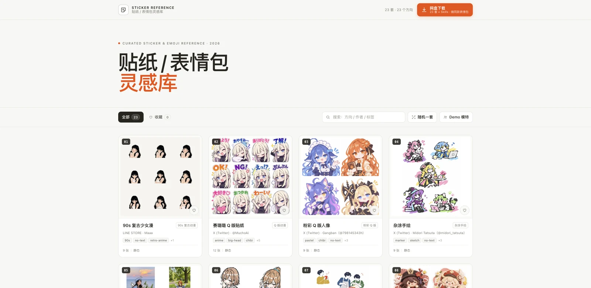
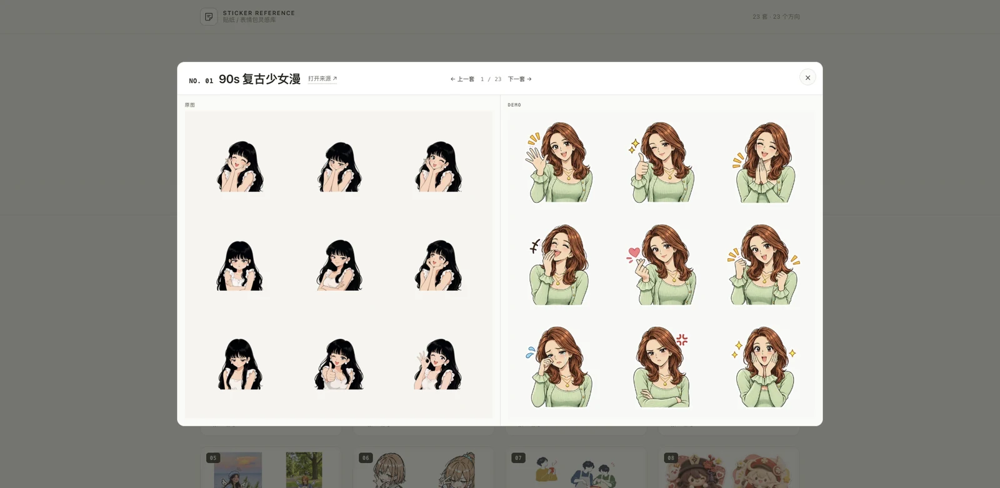
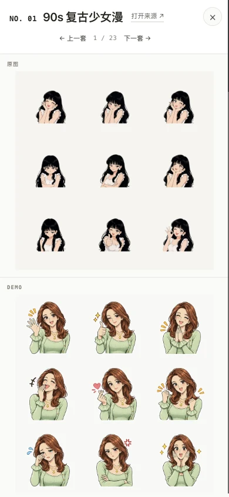
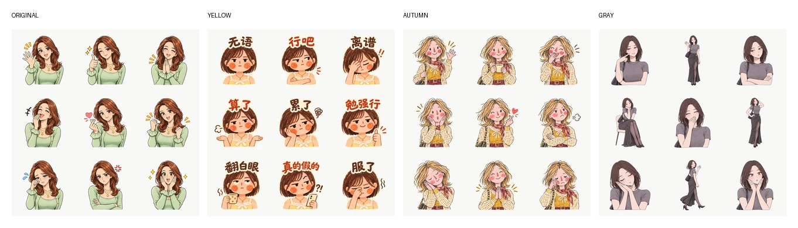

# 贴纸 / 表情包灵感库

**23 套风格迥异的表情包**

线上：https://sleepyzone.online/sticker-library-cn/  
GitHub Pages：https://sleepy-zone.github.io/sticker-library-cn/

90s 复古动漫、Q 版动漫、粉彩 Q 版人像、杂涂手绘、照片手绘混合、稚拙涂鸦、柔和绘本、软陶立体贴纸、圆润 Q 版、猫猫反应表情、柔和灰调动漫、蜡笔质感、粉色贴纸排版、和纸拼贴、日文粉彩大头、羊毛毡娃娃、Riso 独立志、儿童蜡笔肖像、3D 搪胶玩具、像素 Q 版、粗黑线梗图、手绘动画概念、简笔水粉头像

## 网盘下载

右上角「网盘下载」包含本站 23 套表情包与 Skills，可做同款表情包：

https://pan.quark.cn/s/b80a94cc8fc1







## 预置四个角色

角色在 https://sleepyzone.online/ai-ref-library-cn/ 生成。



## 图片 CDN

站点运行时通过 `data/mirror-snapshot.js` 把图片路径解析到 CDN：

- 首页卡片、详情左栏使用原图 CDN
- 详情右栏使用 Pack 预览 CDN
- Demo 模特弹窗使用模特 CDN
- 本地 `images/` 保留为离线兜底
- 共 51 个 CDN 地址，换图只需改这一份映射

## 埋点

和 `char-db-cn` 共用同一个 Clarity 项目（`r1wmvdsf4a`），配置在 `data/analytics-config.js`。

- 页面：`site_view`
- 卡片：`item_open`
- 搜索：`search`
- 筛选：`filter`
- 收藏：`fav`
- 随机：`random`
- 上一套/下一套：`step`
- 来源点击：`source_click`
- 网盘下载：`download_click`
- Demo 模特：`models_open`

本地调试：控制台执行 `window.__trackDebug = true` 后刷新，或查看 `window.__trackLog`（最近 200 条）。

## 本地预览

```bash
cd sticker-library-cn
python3 -m http.server 8080
# open http://localhost:8080
```
